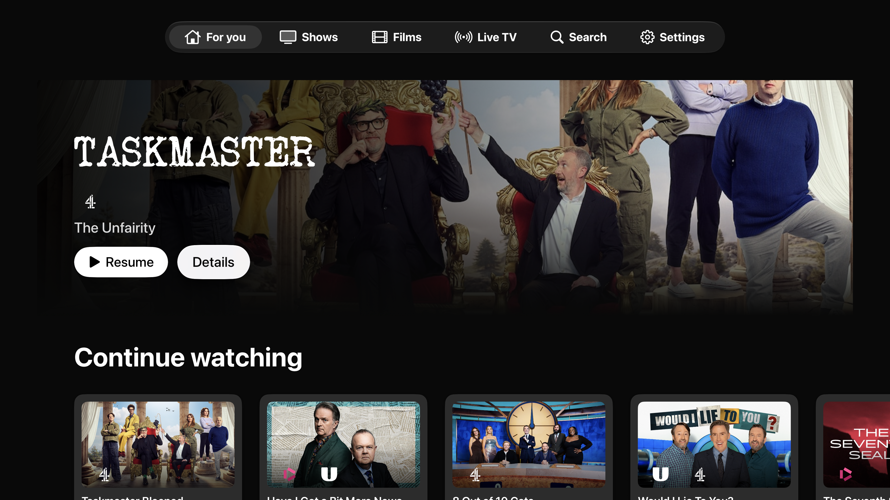
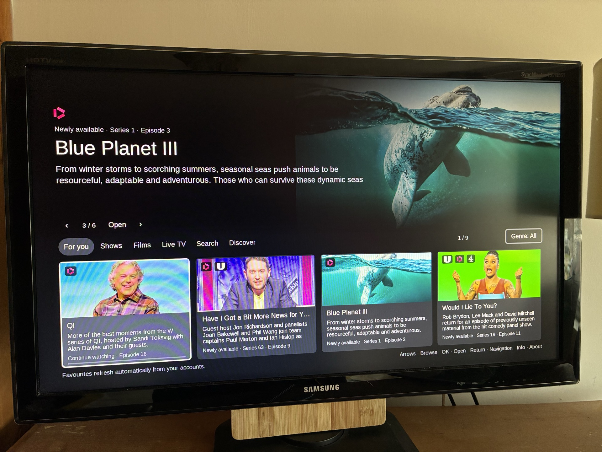

# Watch

Watch brings a shared television library to Apple TV, Home Assistant and Samsung Smart Hub, backed by a Raspberry Pi.

| Part | Source | Purpose |
| --- | --- | --- |
| Pi server / host | [server](server/) | Installed bridge, shared catalogue and playback services, companion gateways and service units |
| Apple TV app | [apple-tv](apple-tv/) | Native tvOS app and Xcode project |
| Home Assistant dashboard | [home-assistant](home-assistant/) | Watch card, dashboard YAML, browser player and bridge source |
| Samsung app | [samsung](samsung/) | Samsung Orsay widget, packaging tools and launcher |

This repository groups the existing components without changing the running installation. The server folder preserves the installed directory names and imports. Component READMEs describe their existing configuration and operation; paths and network addresses in examples reflect the original Pi installation and should be adapted for another host.

## Latest updates · 7 November 2026

- Apple TV build 63: cinematic heroes and themed shelves, portrait artwork, daily discovery rows, exact Christmas episode links, sidebar navigation that returns to each section’s root, and a new artwork-led Up next card.
- Playback: native controls, verified intro/recap skipping, automatic Up next, chronological QI lettered-series queues, and ahead-of-time credits analysis combining picture text with closing music. Autoplay waits for the episode to finish.
- Scene lighting: live transport-menu controls for sample window, fade, saturation and brightness matching, neutral-to-white behaviour and optional look-ahead. Calibration and original lamp-state restoration are preserved.
- Pi host: bounded, paired ending previews and analysis diagnostics, reviewed clear-logo matches, and the shared playback-feature APIs. Samsung and Home Assistant sources remain included alongside the host and tvOS app.

See [build 63 release and validation notes](docs/RELEASE-2026-11-07.md), [credits detection](docs/VISUAL-CREDITS.md), [scene-lighting controls](docs/SCENE-LIGHTING-CONTROLS.md), [Apple TV notes](apple-tv/README.md), and the [playback API contract](docs/PLAYBACK-FEATURES-API.md).

BBC UHD uses the installation owner's privately provisioned setup; no client identity, private key or account session is included. The previous build-37 checkpoint is retained as `checkpoint-appletv-build-37`.

## Screenshots

### Apple TV

### Home Assistant

### Samsung Smart Hub

Photograph of the app running on physical Samsung hardware.

These repository previews illustrate the interfaces; appearance and content may differ on a current installation.

## AirPlay to the Samsung network player

The [Samsung AirPlay bridge](server/samsung-airplay/) records the Raspberry Pi 500 implementation and tests from 1 November 2026: YouTube and BBC iPlayer from an iPhone, 720p50 H.264/AAC remuxing without transcoding, and confirmed picture, sound and transport controls. It includes the pinned UxPlay callback patch, adapter, service definitions and test limits.

## Samsung Auto Ticker autostart

Watch now has a confirmed native autostart route on the Samsung T27B551 with firmware 1013.0. It uses two TVMW profile settings while keeping the app as an ordinary `ticker=n` widget. Read the [exact setup, verification and recovery guide](samsung/AUTOSTART.md) before reproducing it. Samsung release 0.329 includes transparent playback controls, smaller consistent BBC channel marks, taller card artwork and a topical home row led by the latest unfinished episode.

## Getting started

1. Read [the Pi host guide](server/README.md) and configure the three services using their `settings.example.json` files.
2. Open `apple-tv/Watch.xcodeproj` in Xcode for the tvOS app. `apple-tv/Gateway` links to the server's Watch gateway.
3. Add the Home Assistant card resource and use `home-assistant/dashboard.yaml`.
4. Build the Samsung widget with `samsung/build.py`; provide its device key privately at packaging time.

## Source snapshot

Imported on 29 October 2026. Server runtime files were read from the Pi, with local source bundles supplying project assets, documentation and tests. The Samsung widget was also read from the Pi. The Apple TV Xcode project and Home Assistant source came from the existing development workspace. The dashboard YAML matches the installed Watch dashboard.

The initial import was a source snapshot; subsequent Samsung updates and the native autostart investigation are now tracked here. Repository changes are not automatically deployed to the Pi. The paired TV packages and installation state remain private to the host.

## Private configuration

Real `settings.json` files, provider sessions, Home Assistant tokens, pairing/device keys, signing files, catalogues, viewing history, cache, diagnostics and built app packages are excluded. Samsung's checked-in connection file contains only a placeholder. Recreate private configuration locally from the examples; do not commit credentials.

## Licences and acknowledgements

Apple TV includes GPL-3.0-or-later code and its notices in [apple-tv/NOTICE.md](apple-tv/NOTICE.md) and [apple-tv/LICENSE.txt](apple-tv/LICENSE.txt). HLS.js notices and broadcaster artwork attribution remain alongside the components. See component notices for third-party terms; no blanket licence is assigned to unrelated components.
